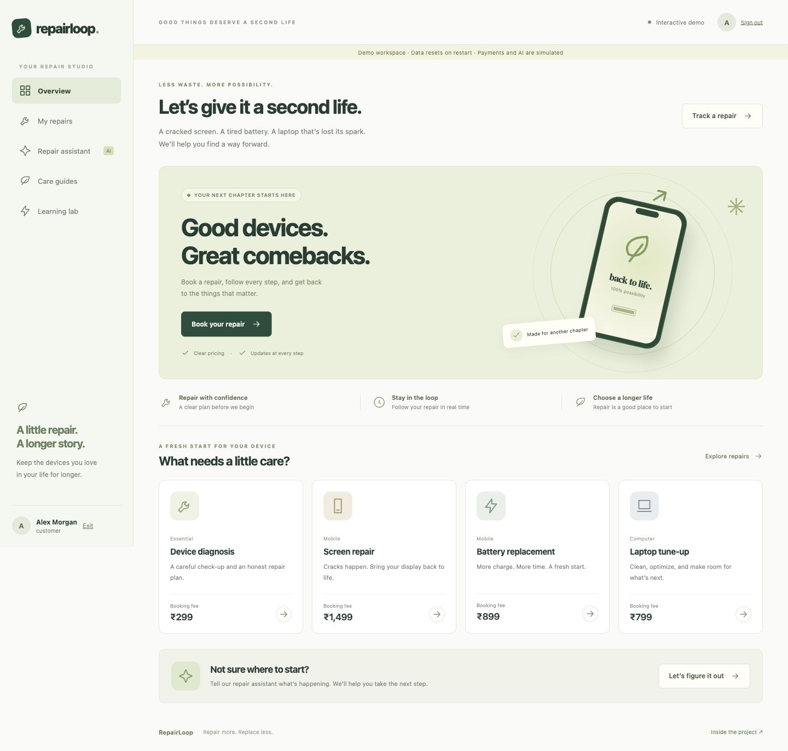

# RepairLoop

[GitHub repository](https://github.com/Lathikaa-S/repairloop) · [Passing application CI](https://github.com/Lathikaa-S/repairloop/actions/runs/43436998765)

An electronics repair studio: book a repair, upload device photos, pay a booking fee, follow real-time progress, maintain care guides, and ask an AI repair-intake assistant for safe next steps.



Built as one assessment project covering the supplied **63-concept rubric**, including **25 mandatory concepts**. Coverage means identifiable implementation and demonstration paths—not guaranteed marks. Some external integrations require credentials and live verification. Read [VERIFICATION.md](VERIFICATION.md) before claiming evidence.

## Start here

1. Run the demo below and complete a booking.
2. Read [PRD.md](PRD.md), [HLD.md](HLD.md), and [LLD.md](LLD.md).
3. Open [CONCEPTS.md](CONCEPTS.md) for all 63 concepts and their code locations.
4. Use [docs/VIVA_GUIDE.md](docs/VIVA_GUIDE.md) to trace, explain, and modify the implementation.
5. Configure [live services](docs/SETUP.md), then follow [deployment](docs/DEPLOYMENT.md).

## Run immediately: no external accounts

Requirements: Node.js 22.13+ and npm. Commands run from this repository's root.

```bash
npm ci                         # Install the exact locked dependency versions.
npm run db:generate             # Generate the Prisma client used by the SQL adapter.
npm run dev                    # Start Express + Vite + React SSR on port 3000.
```

Open http://localhost:3000. The login page has buttons to fill these **public demo accounts**:

| Role | Email | Password |
|---|---|---|
| Customer | alex@repairloop.local | RepairLoopDemo123! |
| Technician/admin | admin@repairloop.local | RepairLoopDemo123! |

Demo mode uses in-memory adapters, simulated payments, and a rule-based assistant. It resets on restart and proves no real MongoDB, PostgreSQL, Redis, payment-provider or LLM behavior. Production refuses demo mode. To override the local port, run `PORT=3210 APP_URL=http://localhost:3210 npm run dev`.

If Prisma cannot write its local cache, use `XDG_CACHE_HOME=/tmp/repairloop-cache npm run db:generate`. If npm's default cache has permission problems, append `--cache /tmp/repairloop-npm-cache` to `npm ci`.

## Stack and responsibilities

| Layer | Technology | Purpose |
|---|---|---|
| UI | React 19, React Router, CSS | Controlled forms, routing, accessible feedback, responsive layout |
| Rendering | Vite + ReactDOMServer | Public catalog SSR followed by hydration |
| API | Node.js, Express 5, Zod | REST, middleware, typed runtime validation, SSE |
| Relational data | PostgreSQL + Prisma | Accounts, services, bookings, payments, timeline and files |
| Document data | MongoDB + Mongoose | Repair articles, embedded tags/revisions, vector arrays, AI usage |
| Cache | Redis | Catalog TTL cache and one-time OAuth state |
| Identity | bcrypt, JWT, Google OAuth | Password login, signed HttpOnly cookies, staff roles |
| Payments | Razorpay | Server-created orders, signature checks, capture checks and webhooks |
| AI | OpenAI Responses + embeddings | Structured advice, tools, bounded agent loop, retrieval and streaming |
| Operations | Socket.IO, node-cron, Docker, GitHub Actions | Updates, reminders, containers and CI |

## Useful commands

```bash
npm test                       # Unit + HTTP API tests; real-service test is skipped here.
npm run build                  # Browser assets and server-side React bundle.
npm run test:integration        # Requires migrated PostgreSQL, MongoDB and Redis test databases.
npm run check:coverage          # Verify all 63 evidence entries and referenced files exist.
npm run ai:eval                 # Demo evaluation by default; live mode invokes the provider.
npm run db:migrate              # Apply versioned SQL migrations.
npm run db:seed                 # Add catalog, guides and an admin with your configured password.
npm run ai:index                # Embed Mongo guides; requires an API key and incurs API usage.
npm start                      # Production: APP_MODE=live and external services required.
```

## Main user journey

Sign in → choose a service → describe device/problem → create request → upload a photo → pay the booking fee → technician confirms → repair starts → ready for collection → collected. Customer and staff views refresh through authenticated WebSocket events. Ready devices receive a persistent pickup reminder after 24 hours, checked hourly.

Only staff can edit care guides or advance repair states. Customers cannot set prices, roles, payment status, or other customers' IDs through request bodies.

## Repository tour

```text
client/App.jsx           React pages and reusable UI components
client/api.js            HTTP client, SSE parser, checkout loader closure
client/js-lab.js         Runnable JS concepts used by /lab and tests
server/app.js            REST routes, validation, auth, uploads and error boundary
server/store.js          Real PostgreSQL adapter and explicitly separate demo adapter
server/knowledge.js      Mongo models, CRUD, indexing and aggregations
server/ai.js             Prompt, structured output, retrieval, tools, agent and usage
server/payments.js       Razorpay orders, verification and webhook processing
server/oauth.js          Google authorization-code login
server/index.js          SSR host, authenticated Socket.IO and scheduled job
prisma/                  Schema and committed SQL migration
tests/                   Unit, HTTP, integration, provider-contract tests and eval cases
docs/                    Setup, deployment, viva and architecture explanations
```

Explanatory comments focus on why the code exists, trust boundaries, and important failure cases. Formatting is intentionally readable; use the concept map to locate each demonstration.

## Scope limits

This is a learning project, not an audited commercial repair/payment platform. It has no refunds, inventory, technician assignment, password-reset/email-verification workflow, global session revocation, or multi-instance Socket.IO coordination. See the design documents for trade-offs. Never commit `.env`, real customer records, uploaded photos, or provider credentials.

AI-assisted implementation is disclosed. Study and adapt it, and explain it in your own words. Do not use external assistance during a proctored viva.
